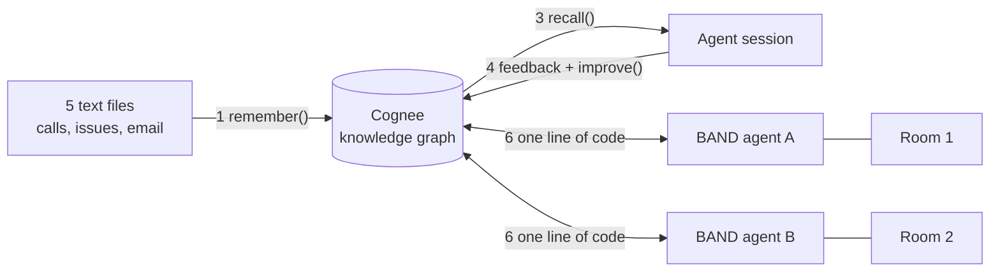

# Give BAND agents a shared memory with Cognee

A hands-on session, about 30 minutes. You copy one command per step.

You take a small team's calls, issues and email, and turn them into a memory with
[Cognee](https://www.cognee.ai). Then you connect two [BAND](https://band.ai) agents to
that memory. At the end, one agent knows what the other one was told, in a room it was
never in.


The data is fictional: a team called Acorn is launching "Checkout v2".

## What you build



| Step | You run | You see |
|---|---|---|
| 0 | Install | `OK: ready` |
| 1 | Give Cognee the data | 5 files stored, a graph built |
| 2 | Open the graph | People, issues and deadlines, linked |
| 3 | An agent asks questions | An answer that joins a call, Linear and an email |
| 4 | Feedback, then improve | The same question, a new answer |
| 5 | Permissions | A second user: no access, then access |
| 6 | Connect two BAND agents | Agent B knows what agent A was told |

## Step 0: Install

You need two things:

- an OpenAI API key, from https://platform.openai.com/api-keys (it starts with `sk-`)
- for step 6 only: a free BAND account. You create it in step 6.

You do not need to install anything first. Open a terminal and paste **one line**.

**Windows.** Open **PowerShell** (press the Windows key, type `powershell`, press Enter).
Do not use Command Prompt (cmd). Paste this and press Enter:

```powershell
irm https://raw.githubusercontent.com/jure-cognee/band-cognee-workshop/main/install.ps1 | iex
```

**macOS or Linux.** Open Terminal. Paste this and press Enter:

```bash
curl -LsSf https://raw.githubusercontent.com/jure-cognee/band-cognee-workshop/main/install.sh | bash
```

It asks for one thing, your OpenAI key. Paste it and press Enter. Then it downloads the
workshop into a folder called `band-cognee-workshop`, installs everything inside that
folder, and checks it. Wait for these lines:

```text
[check] Cognee 1.6.6
[check] LLM_API_KEY is set
[check] OK: ready. Next: uv run python 01_ingest.py
```

Then follow the last lines it prints. On Windows you are already in the workshop folder.
On macOS or Linux, run the `cd band-cognee-workshop` line it shows you.

The first run takes a few minutes. Do it before the session starts. If something goes
wrong, or you come back later, paste the same line again: it is safe to run many times.

**From here on, every command is the same on Windows, macOS and Linux.**

## Step 1: Give Cognee the data

Look at the data first. It is five short text files in the folder `data/`:

- `data/calls/`: two calls. The latest one agrees three next steps, but it never says
  which team, which issue or which date.
- `data/linear/`: two Linear issues, PAY-104 and PLAT-88.
- `data/email/`: one email from a bank with a deadline.

Now run:

```bash
uv run python 01_ingest.py
```

You should see (it takes about a minute):

```text
[ingest] Remembered 2 file(s) from data/calls/
[ingest] Remembered 2 file(s) from data/linear/
[ingest] Remembered 1 file(s) from data/email/
[ingest] Done. Next: uv run python 02_graph.py
```

**What happened.** `remember()` stored the text and built a knowledge graph from it. The
block prints the extraction prompt first. That prompt tells the LLM what to pull out of
the text. You can change it in `01_ingest.py` and run the block again.

```python
await cognee.remember(
    texts,
    dataset_name="checkout_v2",
    node_set=[source],                 # "calls", "linear" or "email"
    custom_prompt=EXTRACTION_PROMPT,   # what to extract
)
```

## Step 2: Look at the graph

```bash
uv run python 02_graph.py
```

The first run downloads the UI, so it takes a minute or two. Wait for the box that says
**The graph is ready**. Lines that start with `[frontend]` are normal.

1. Open http://localhost:3000 in your browser.
2. Click **Sign in**. The email and password are already filled in. It is Cognee's local
   default user, and the server only runs on your machine.

   

3. Click **Graph** in the left menu. Pick the dataset `checkout_v2`. At the bottom, click
   **Records**. The page title says **Mindmap**: that is Cognee's name for the graph view.

   

4. Type `Omar` in the search box and pick **omar haddad**. Follow the lines from him:
   the Payments team, the issue PAY-104, the bank and its deadline.

   

**What to notice.** Omar's team comes from the old call. PAY-104 comes from Linear. The
deadline comes from the email. Nobody linked these by hand.

**Stop it before the next step.** This step does not end by itself. Click the terminal
window and press **Ctrl+C**. It then prints the command for step 3.

## Step 3: An agent uses the memory

```bash
uv run python 03_agent_session.py
```

The agent asks for the next steps of the latest call, with owner, team, due date and
issue for each. You should see something like:

```text
[agent] A: - Migrate card payments to 3DS2 — Owner: Omar Haddad; Team: Payments; Due: 2026-12-10; Linear: PAY-104
[agent] A: PAY-104 is due 2026-12-10, a date set by Kestrel Bank Merchant Services in its email.
```

**What to notice.** The call never says "Payments", "PAY-104" or "2026-12-10". Open
`data/calls/02_checkout_v2_launch_readiness.txt` and check. The answer has all three,
because the graph links the call to the older call, to Linear and to the bank's email.

```python
await cognee.recall(question, datasets=["checkout_v2"], session_id="workshop_session")
```

`session_id` keeps the questions and answers together as one session.

## Step 4: Feedback, then improve

The bank moved the deadline. The memory is now wrong. Fix it:

```bash
uv run python 04_feedback_improve.py
```

You should see (about a minute):

```text
[feedback] Rated the last answer 1 out of 5
[feedback] Added to the session: Update from Lena Fischer on 2026-11-11: Kestrel Bank moved the 3DS2 deadline. PAY-104 is now due on 2027-01-15, not 2026-12-10.
...
[improve] Q: When is PAY-104 due?
[improve] A: PAY-104 is due 2027-01-15.
```

**What happened.** The block rated the old answer as bad, added the new fact to the
session, and called `improve()`. `improve()` moves what the session learned into the
graph. The same question now gives the new date.

```python
await cognee.session.add_feedback(session_id=SESSION, qa_id=last.qa_id, feedback_score=1, ...)
await cognee.remember(NEW_FACT, dataset_name=DATASET, session_id=SESSION)
await cognee.improve(DATASET, session_ids=[SESSION])
```

To see the change in the graph, run step 2 again.

## Step 5: Permissions

```bash
uv run python 05_permissions.py
```

You should see:

```text
[permissions] agent-b@example.com asks before any permission: Who owns PAY-104 and when is it due?
  No access: this user has no read permission on the dataset.

[permissions] The owner gave agent-b@example.com read permission on checkout_v2

[permissions] agent-b@example.com asks again: Who owns PAY-104 and when is it due?
  A: PAY-104 is owned by Omar Haddad and is due 2027-01-15.
```

**What happened.** A second user asked and got nothing. The owner gave that user read
permission on the dataset. The same question then worked.

```python
await authorized_give_permission_on_datasets(agent_b.id, [dataset.id], "read", owner.id)
```

## Step 6: Two BAND agents share the memory

[BAND](https://band.ai) puts agents and people in shared rooms. You talk to an agent by
mentioning it with `@`. BAND does not run your agent: the agent is a small program on
your machine that connects to BAND.

On its own, a BAND agent forgets everything when a room ends. This step gives two agents
the memory you built in steps 1 to 5.

Run this one command, in the same terminal window you used for steps 1 to 5:

```bash
uv run python 06_band.py
```

Everything happens in that one window. It tells you where to click in BAND and gives you
the text to paste. You never open or edit a file. It has three parts.

**Part 1: you make two agents in BAND.** You do not have them yet. The terminal shows
these steps and waits for you:

1. Open https://app.band.ai and sign in (or click **Create account**).
2. Click **Agents** in the left menu, then **Connect remote agent**.
3. Fill in the name and the description from the table below. Leave everything else as
   it is. Click **Connect Agent**.
4. BAND shows an **ID** and an **API Key**. Copy the ID, paste it into the terminal, press
   Enter. Then do the same with the API key. The API key is shown only once.
5. Do the same again for agent B.

| | Agent name | Description |
|---|---|---|
| Agent A | `Cognee Agent A` | `Workshop agent A. Answers questions about the Checkout v2 project from shared Cognee memory.` |
| Agent B | `Cognee Agent B` | `Workshop agent B. Answers questions about the Checkout v2 project from shared Cognee memory.` |

When you are done, your Agents page in BAND looks like this:


**Part 2: it starts everything.** The Cognee server and both agents start in the
background. Wait until it says both agents are ready. The first time takes a few minutes.

**Part 3: you talk to the agents in BAND.** The terminal shows each click and gives you
the exact text to copy:

1. Open a room with agent A: **Agents**, then **Cognee Agent A**, then **Create room**.
   Type `@`, pick **Cognee Agent A**, and paste the question. It answers from the memory
   you built, with the date you fixed in step 4.

   

2. In the same room, tell agent A a new fact. Then press Enter in the terminal. Agent A is
   switched off, and its room moves into the shared memory. This takes one minute.
3. Look at the graph at http://localhost:3000 and search for `Lena`. The fact you gave
   to agent A in BAND is now in the graph, linked to Lena Fischer and Omar Haddad.
4. Open a new room with agent B: **Agents**, then **Cognee Agent B**, then **Create
   room**. Type `@`, pick **Cognee Agent B**, and paste the question about that fact.

   

**What to notice.** Agent B was never in the first room, and agent A is not even running.
Agent B knows because both agents read and write the same Cognee memory.

Press Enter one last time and everything is switched off.

### Step 6 by hand (optional)

`06_band.py` runs three programs for you. To see them yourself, use three terminal
windows in the workshop folder. Each one prints what to do next.

| Window | Run | What it is |
|---|---|---|
| 1 | `uv run python 06_server.py` | The Cognee server. Leave it open |
| 2 | `uv run python 06_api_key.py`, then `uv run --env-file .env 06_band_agent.py a` | A key for the server, then agent A |
| 3 | `uv run --env-file .env 06_band_agent.py b` | Agent B |

Run `06_band.py` once first, so your BAND agents are saved. To switch agent A off by hand,
press Ctrl+C in window 2. To check the memory path without BAND:
`uv run --env-file .env 06_check_memory.py`.

## What the BAND agent looks like

All of `06_band_agent.py` is about 50 lines. This is the part that matters:

```python
inner = PydanticAIAdapter(                       # a normal BAND agent on an OpenAI model
    PydanticAIAdapterConfig(model="openai:gpt-5.6-luna", custom_section="..."),
    additional_tools=cognee_tools(client),       # optional: cognee_search, cognee_remember
)

agent = Agent.create(
    adapter=CogneeMemoryAdapter(inner, settings=settings, client=client),   # the one line
    agent_id=os.environ["BAND_AGENT_A_ID"],
    api_key=os.environ["BAND_AGENT_A_API_KEY"],
)
await agent.run()
```

`CogneeMemoryAdapter` does three things: before each message it recalls memory and adds
it to the message; after each reply it stores the question and the answer; when a room
ends or the agent stops it moves that room into the graph. It comes from
[cognee-integration-band](https://github.com/topoteretes/cognee-integrations/tree/main/integrations/band).

## If something goes wrong

| You see | Do this |
|---|---|
| Anything fails in step 0 | Paste the one line from step 0 again. It continues where it stopped |
| `uv` is not recognized, or `command not found: uv` | Close the terminal, open a new one, and paste the one line from step 0 again |
| You are not in the workshop folder (`can't open file`, `No such file`) | `cd band-cognee-workshop`, then run the command again |
| `can't open file ... 06_band.py` (or another file from this page is missing) | Your copy of the workshop is older than this page. Paste the one line from step 0 again. It updates your copy and keeps your key |
| `Could not find lbug C API shared library` (macOS) | `brew install openssl@3`, then `uv run python reset.py`, then step 1 again |
| `no such table: principals` | `uv run python reset.py`, then step 1 again |
| `Could not download Node.js 22` | Check your internet connection and run step 2 again. Or install Node.js 22 from https://nodejs.org/en/download, open a new terminal, then step 2 again |
| The page at localhost:3000 says "Internal Server Error" | The UI is running on the wrong Node.js. Stop it with Ctrl+C and run step 2 again |
| Step 2 or 6: `Address already in use`, or `already running on port 8000` | Step 2 is still open in another window. Click that window, press Ctrl+C, then run the step again |
| Step 6: an agent `stopped by itself` with `UnauthorizedError` | The BAND ID or API key is wrong. In BAND, open the agent's menu, choose **Regenerate API key**. Run `uv run python 06_band.py` again, answer `n` to "Use them?", and paste the new values |
| Step 6: an agent `stopped by itself` for another reason | Read the lines it shows from `runs/`. Then run `uv run python 06_band.py` again |
| The agent does not answer in the room | Your message must mention it. Type `@` and pick the agent from the list |
| Agent B does not know the new fact | Wait a minute and ask again in a new room |
| You want to start over | Run step 1 again. It clears the dataset first. For a full reset: `uv run python reset.py` |

## Files

| File | What it is |
|---|---|
| `data/` | The five sample files |
| `00_check.py` to `05_permissions.py` | Steps 0 to 5, one file each |
| `06_band.py` | Step 6, guided, in one terminal |
| `06_server.py`, `06_api_key.py`, `06_band_agent.py` | The three programs that `06_band.py` runs for you |
| `workshop.py` | The messages that tell you what to do next |
| `06_check_memory.py` | Step 6 without BAND, to test the setup |
| `install.ps1`, `install.sh` | Step 0 in one line: get the workshop and run the setup |
| `setup.ps1`, `setup.sh` | The setup itself. The installer runs it for you |
| `node22.py` | Gets Node.js 22 for step 2 if you don't have it, into the folder `.node/` |
| `reset.py` | Deletes Cognee's local databases, to start over |
| `run.sh` | macOS or Linux: `bash run.sh 03` runs a step and saves its output in `runs/` |
| `PRESENTER.md` | Script and timing for the person who runs the session |
| `BAND_NOTES.md` | What BAND is and how its parts work, from BAND's docs |
