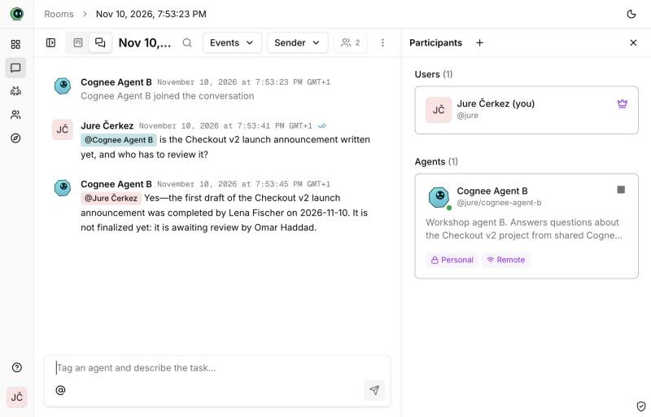
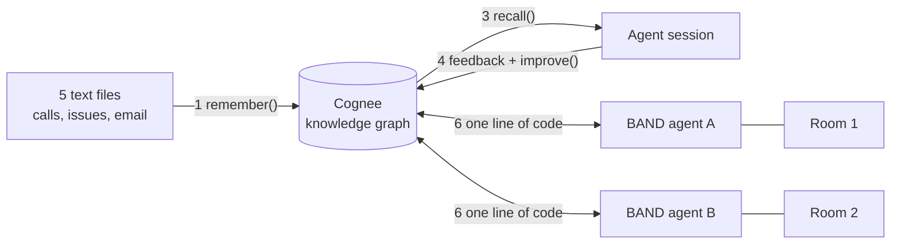
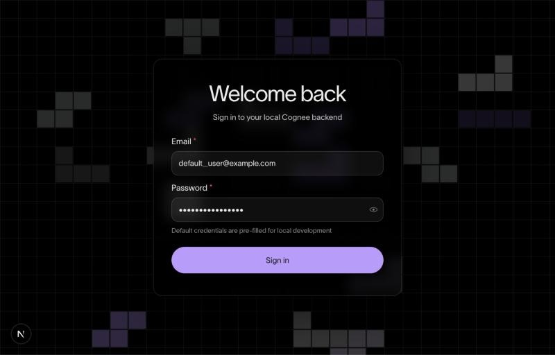
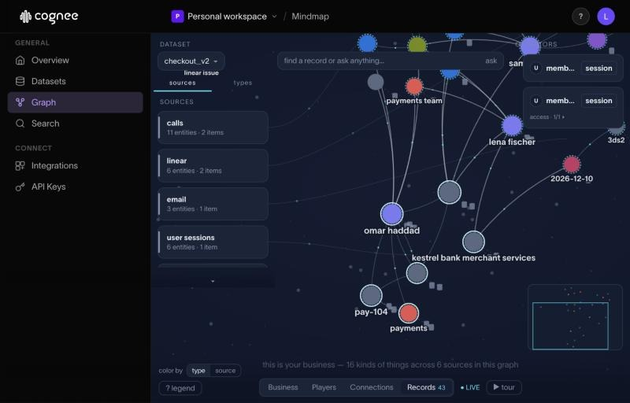
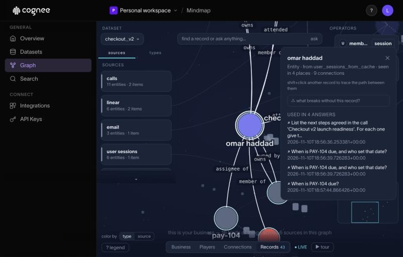
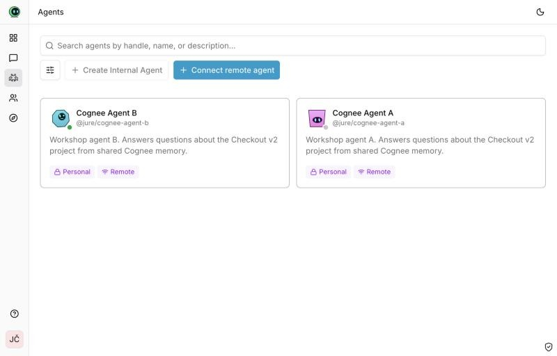
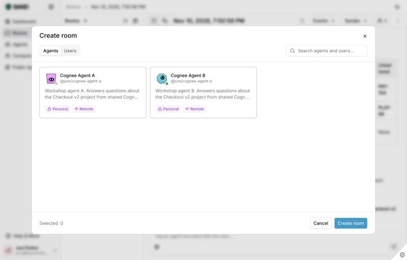
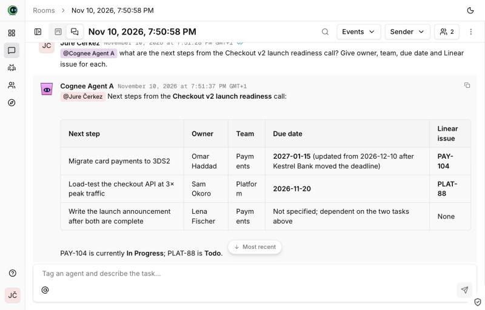

# Give BAND agents a shared memory with Cognee

A hands-on session, about 30 minutes. You copy one command per step.

You take a small team's calls, issues and email, and turn them into a memory with
[Cognee](https://www.cognee.ai). Then you connect two [BAND](https://band.ai) agents to
that memory. At the end, one agent knows what the other one was told, in a room it was
never in.



The data is fictional: a team called Acorn is launching "Checkout v2".

## What you build



| Step | You run | You see |
|---|---|---|
| 0 | Install | `OK: ready` |
| 1 | Give Cognee the data | 5 files stored, a graph built |
| 2 | Open the graph | People, issues and deadlines, linked |
| 3 | An agent asks questions | An answer that joins a call, Linear and an email |
| 4 | Feedback, then improve | The same question, a new answer |
| 5 | Permissions | A second user: no access, then access |
| 6 | Two BAND agents | Agent B knows what agent A was told |

## Step 0: Install

You need these four things. Check each one before you go on.

| You need | Check it | If it is missing |
|---|---|---|
| [uv](https://docs.astral.sh/uv/) | `uv --version` | `curl -LsSf https://astral.sh/uv/install.sh \| sh` |
| Node.js 22 | `node --version` prints `v22...` | With [nvm](https://github.com/nvm-sh/nvm): `nvm install 22 && nvm use 22` |
| An OpenAI API key | starts with `sk-` | https://platform.openai.com/api-keys |
| macOS only: OpenSSL 3 | `brew list openssl@3` | `brew install openssl@3` |

For step 6 you also need a free BAND account. You create it in step 6.

Get the code:

```bash
git clone https://github.com/jure-cognee/band-cognee-workshop.git
cd band-cognee-workshop
cp .env.example .env
```

Open the file `.env` in any editor. Put your OpenAI key after `LLM_API_KEY=`, on the same
line, with no spaces:

```text
LLM_API_KEY=sk-...your key...
```

Install and check:

```bash
uv sync
uv run python 00_check.py
```

You should see:

```text
[check] Cognee 1.6.6
[check] LLM_API_KEY is set
[check] OK: ready. Next: uv run python 01_ingest.py
```

`uv sync` takes a few minutes the first time. Do it before the session starts.

## Step 1: Give Cognee the data

Look at the data first. It is five short text files in the folder `data/`:

- `data/calls/`: two calls. The latest one agrees three next steps, but it never says
  which team, which issue or which date.
- `data/linear/`: two Linear issues, PAY-104 and PLAT-88.
- `data/email/`: one email from a bank with a deadline.

Now run:

```bash
uv run python 01_ingest.py
```

You should see (it takes about a minute):

```text
[ingest] Remembered 2 file(s) from data/calls/
[ingest] Remembered 2 file(s) from data/linear/
[ingest] Remembered 1 file(s) from data/email/
[ingest] Done. Next: uv run python 02_graph.py
```

**What happened.** `remember()` stored the text and built a knowledge graph from it. The
block prints the extraction prompt first. That prompt tells the LLM what to pull out of
the text. You can change it in `01_ingest.py` and run the block again.

```python
await cognee.remember(
    texts,
    dataset_name="checkout_v2",
    node_set=[source],                 # "calls", "linear" or "email"
    custom_prompt=EXTRACTION_PROMPT,   # what to extract
)
```

## Step 2: Look at the graph

```bash
uv run python 02_graph.py
```

Wait for this line (the first run downloads the UI, so it takes longer):

```text
[graph] Open http://localhost:3000 and click Sign in (the login is already filled in).
```

1. Open http://localhost:3000 in your browser.
2. Click **Sign in**. The email and password are already filled in. It is Cognee's local
   default user, and the server only runs on your machine.

   

3. Click **Graph** in the left menu. Pick the dataset `checkout_v2`. At the bottom, click
   **Records**.

   

4. Type `Omar` in the search box and pick **omar haddad**. Follow the lines from him:
   the Payments team, the issue PAY-104, the bank and its deadline.

   

**What to notice.** Omar's team comes from the old call. PAY-104 comes from Linear. The
deadline comes from the email. Nobody linked these by hand.

Press **Ctrl+C** in the terminal to stop the UI before the next step.

## Step 3: An agent uses the memory

```bash
uv run python 03_agent_session.py
```

The agent asks for the next steps of the latest call, with owner, team, due date and
issue for each. You should see something like:

```text
[agent] A: - Migrate card payments to 3DS2 — Owner: Omar Haddad; Team: Payments; Due: 2026-12-10; Linear: PAY-104
[agent] A: PAY-104 is due 2026-12-10, a date set by Kestrel Bank Merchant Services in its email.
```

**What to notice.** The call never says "Payments", "PAY-104" or "2026-12-10". Open
`data/calls/02_checkout_v2_launch_readiness.txt` and check. The answer has all three,
because the graph links the call to the older call, to Linear and to the bank's email.

```python
await cognee.recall(question, datasets=["checkout_v2"], session_id="workshop_session")
```

`session_id` keeps the questions and answers together as one session.

## Step 4: Feedback, then improve

The bank moved the deadline. The memory is now wrong. Fix it:

```bash
uv run python 04_feedback_improve.py
```

You should see (about a minute):

```text
[feedback] Rated the last answer 1 out of 5
[feedback] Added to the session: Update from Lena Fischer on 2026-11-11: Kestrel Bank moved the 3DS2 deadline. PAY-104 is now due on 2027-01-15, not 2026-12-10.
...
[improve] Q: When is PAY-104 due?
[improve] A: PAY-104 is due 2027-01-15.
```

**What happened.** The block rated the old answer as bad, added the new fact to the
session, and called `improve()`. `improve()` moves what the session learned into the
graph. The same question now gives the new date.

```python
await cognee.session.add_feedback(session_id=SESSION, qa_id=last.qa_id, feedback_score=1, ...)
await cognee.remember(NEW_FACT, dataset_name=DATASET, session_id=SESSION)
await cognee.improve(DATASET, session_ids=[SESSION])
```

To see the change in the graph, run step 2 again.

## Step 5: Permissions

```bash
uv run python 05_permissions.py
```

You should see:

```text
[permissions] agent-b@example.com asks before any permission: Who owns PAY-104 and when is it due?
  No access: this user has no read permission on the dataset.

[permissions] The owner gave agent-b@example.com read permission on checkout_v2

[permissions] agent-b@example.com asks again: Who owns PAY-104 and when is it due?
  A: PAY-104 is owned by Omar Haddad and is due 2027-01-15.
```

**What happened.** A second user asked and got nothing. The owner gave that user read
permission on the dataset. The same question then worked.

```python
await authorized_give_permission_on_datasets(agent_b.id, [dataset.id], "read", owner.id)
```

## Step 6: Two BAND agents share the memory

[BAND](https://band.ai) puts agents and people in shared rooms. You talk to an agent by
mentioning it with `@`. BAND does not run your agent: the agent is a small program on
your machine that connects to BAND.

On its own, a BAND agent forgets everything when a room ends. One line gives it the
memory you built in steps 1 to 5:

```python
adapter=CogneeMemoryAdapter(inner)   # was: adapter=inner
```

You need three terminals for this step.

### 6.1 Create two agents in BAND

1. Open https://app.band.ai and sign in. If you have no account, click
   **Create account**.
2. Click **Agents** in the left menu, then **Connect remote agent**.
3. **Agent name**: `Cognee Agent A`. **Description**: `Answers questions about the
   Checkout v2 project.` Leave everything else as it is. Click **Connect Agent**.
4. BAND shows an **ID** and an **API Key**. Copy both now. The API key is shown only once.
5. Do the same again for `Cognee Agent B`.



Open `.env` and fill in these four lines with what you copied:

```text
BAND_AGENT_A_ID=...
BAND_AGENT_A_API_KEY=band_a_...
BAND_AGENT_B_ID=...
BAND_AGENT_B_API_KEY=band_a_...
```

### 6.2 Start the Cognee server (terminal 1)

```bash
uv run python 06_server.py
```

You should see this. Leave it running.

```text
[server] Cognee server on http://localhost:8000. Leave this running.
```

### 6.3 Get a key for that server (terminal 2)

```bash
uv run python 06_api_key.py
```

You should see:

```text
[api-key] Saved COGNEE_API_KEY in .env
```

Optional: check the memory path without BAND. It takes about 15 seconds.

```bash
uv run --env-file .env 06_check_memory.py
```

```text
[check] Room 2, agent B's memory has it after 12 seconds.
```

### 6.4 Start the two agents (terminals 2 and 3)

Terminal 2:

```bash
uv run --env-file .env 06_band_agent.py a
```

Terminal 3:

```bash
uv run --env-file .env 06_band_agent.py b
```

Each one is ready when its last line says:

```text
... band.agent: Agent started: Cognee Agent A (band-sdk ...)
```

### 6.5 Ask agent A in a room

1. In BAND, click **Rooms** in the left menu, then **New room** (the **+**).
2. Select **Cognee Agent A** and click **Create room**.

   

3. In the message box, type `@` and pick **Cognee Agent A**. An agent only receives
   messages that mention it. Then type this and press Enter:

   ```text
   what are the next steps from the Checkout v2 launch readiness call? Give owner, team, due date and Linear issue for each.
   ```

Agent A answers from the memory you built, with the date you fixed in step 4:



### 6.6 Tell agent A something new

In the same room, type `@`, pick **Cognee Agent A**, and send:

```text
new fact for the team: Lena Fischer finished the first draft of the Checkout v2 launch announcement today. It is waiting for review by Omar Haddad.
```

Agent A confirms it.

### 6.7 Stop agent A

Go to terminal 2 and press **Ctrl+C**. When an agent stops, the integration moves its
rooms into the graph. Wait about one minute.

### 6.8 Ask agent B in a new room

1. Click **New room** again. This time select **Cognee Agent B**. Click **Create room**.
2. Type `@`, pick **Cognee Agent B**, and send:

   ```text
   is the Checkout v2 launch announcement written yet, and who has to review it?
   ```


**What to notice.** Agent B was never in the first room, and agent A is not even running.
Agent B knows because both agents read and write the same Cognee memory.

When you are done, press **Ctrl+C** in terminals 3 and 1.

## What the BAND agent looks like

All of `06_band_agent.py` is about 50 lines. This is the part that matters:

```python
inner = PydanticAIAdapter(                       # a normal BAND agent on an OpenAI model
    PydanticAIAdapterConfig(model="openai:gpt-5.6-luna", custom_section="..."),
    additional_tools=cognee_tools(client),       # optional: cognee_search, cognee_remember
)

agent = Agent.create(
    adapter=CogneeMemoryAdapter(inner, settings=settings, client=client),   # the one line
    agent_id=os.environ["BAND_AGENT_A_ID"],
    api_key=os.environ["BAND_AGENT_A_API_KEY"],
)
await agent.run()
```

`CogneeMemoryAdapter` does three things: before each message it recalls memory and adds
it to the message; after each reply it stores the question and the answer; when a room
ends or the agent stops it moves that room into the graph. It comes from
[cognee-integration-band](https://github.com/topoteretes/cognee-integrations/tree/main/integrations/band).

## If something goes wrong

| You see | Do this |
|---|---|
| `Could not find lbug C API shared library` (macOS) | `brew install openssl@3`, then `rm -rf .venv/lib/python3.12/site-packages/cognee/.cognee_system`, then step 1 again |
| `no such table: principals` | The same `rm -rf` line, then step 1 again |
| `This block needs Node.js 22 on your PATH` | `nvm install 22 && nvm use 22` in the same terminal, then step 2 again |
| The page at localhost:3000 says "Internal Server Error" | The UI is running on Node 27. Stop it, check `node --version` says 22, run step 2 again |
| Step 2 or 6.2: `Address already in use` | Something else uses port 8000 or 3000. Stop step 2 with Ctrl+C before step 6, and the other way round |
| Step 6.4: `UnauthorizedError` | The BAND id or API key in `.env` is wrong. In BAND, open the agent's menu, choose **Regenerate API key**, and put the new key in `.env` |
| Step 6.4: `KeyError: 'LLM_API_KEY'` or `'BAND_AGENT_A_ID'` | Start the agent with `uv run --env-file .env ...`, and check that line in `.env` |
| The agent does not answer in the room | Your message must mention it. Type `@` and pick the agent from the list |
| Agent B does not know the new fact | Wait a minute and ask again in a new room. Check that you stopped agent A with Ctrl+C |
| You want to start over | Run step 1 again. It clears the dataset first |

## Files

| File | What it is |
|---|---|
| `data/` | The five sample files |
| `00_check.py` to `05_permissions.py` | Steps 0 to 5, one file each |
| `06_server.py`, `06_api_key.py`, `06_band_agent.py` | Step 6 |
| `06_check_memory.py` | Step 6 without BAND, to test the setup |
| `run.sh` | `bash run.sh 03` runs a step and saves its output in `runs/` |
| `PRESENTER.md` | Script and timing for the person who runs the session |
| `BAND_NOTES.md` | What BAND is and how its parts work, from BAND's docs |
